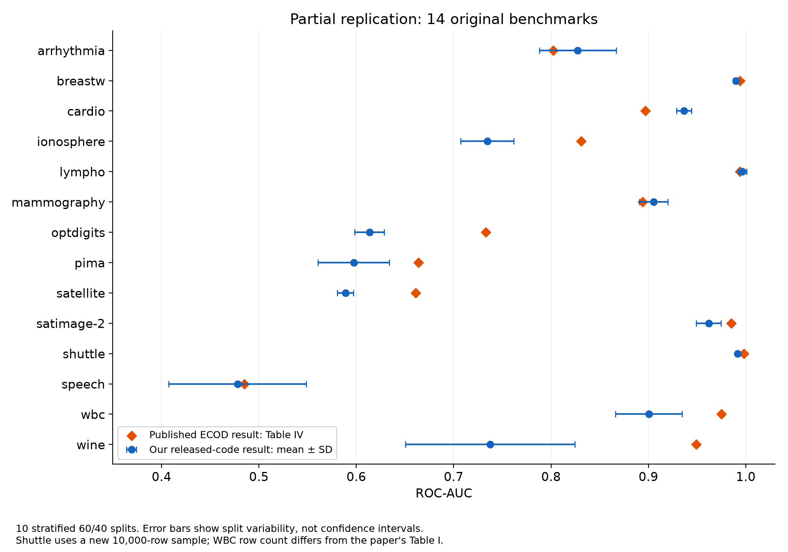
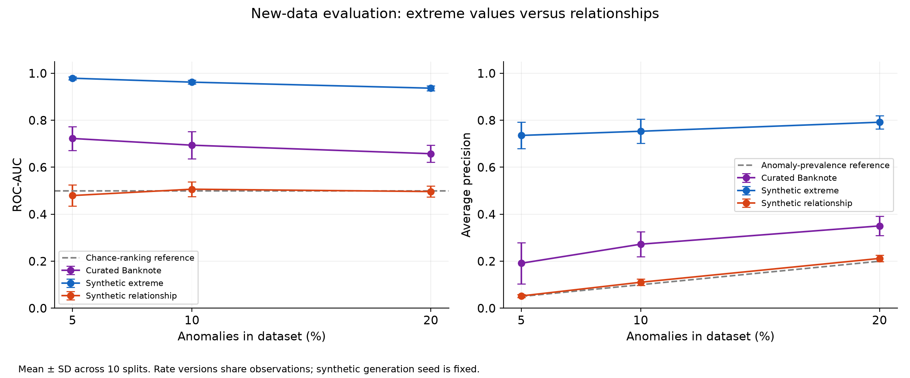
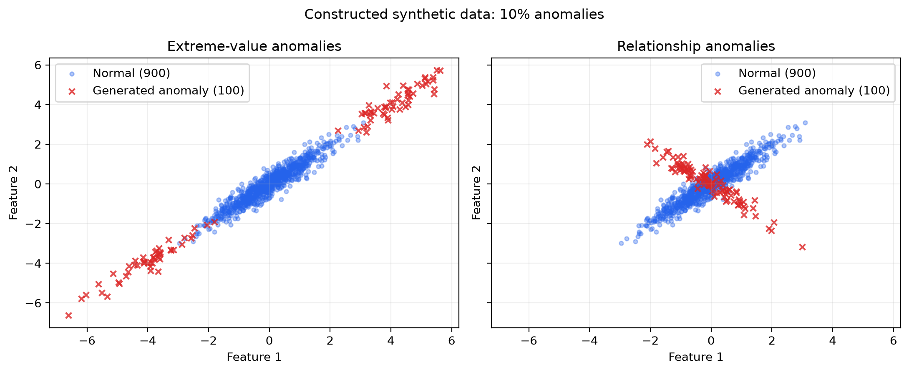
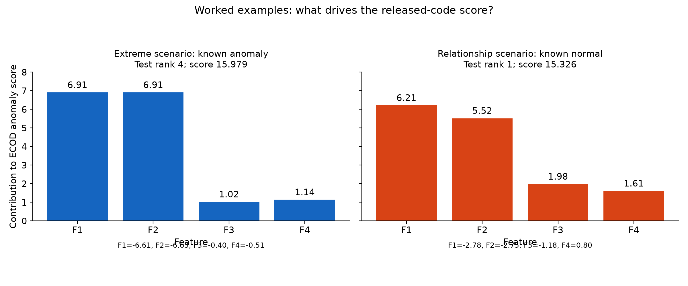

# COMP8240 ECOD replication

Code and recorded results supporting a partial replication of ECOD and extensions on banknote and synthetic data. This repository is separate from the upstream [PyOD project](https://github.com/yzhao062/pyod). It contains project scripts, result summaries, per-split/per-row evidence, and report figures. The report itself is not included or edited.

## Environment

Recorded environment: **64-bit Windows, Python 3.13.7, PyOD 3.6.5, NumPy 2.5.2, SciPy 1.18.1, scikit-learn 1.9.0, pandas 3.0.6, matplotlib 3.11.1**. `requirements.txt` pins these and their relevant dependencies to versions from the working environment. No local PyOD checkout is required.

In PowerShell, change into this repository and run:

```powershell
py -3.13 -m venv .venv
.\.venv\Scripts\python.exe -m pip install -r requirements.txt
.\.venv\Scripts\python.exe -c "import pyod; from importlib.metadata import version; print(version('pyod')); print(pyod.__file__)"
```

Use Python 3.13.7 for the closest match. For the remaining commands, `python` means `.\.venv\Scripts\python.exe`; you can use that full path without activating PowerShell scripts. Run all scripts from the repository root, especially `ecod_reference_sensitivity.py`, which resolves paths from the current working directory. Never install this repository with `pip install -e .`; it is an experiment project, not a PyOD source package. The printed PyOD path should be inside the new environment's `site-packages`.

### Checkout dependence checked

The original project used an editable installation of the local PyOD checkout. For this export, the public PyPI wheel for **pyod==3.6.5** was downloaded and extracted separately. ECOD, BaseDetector, and the main statistical/utility source files matched the checkout after newline normalization. Importing from that wheel reproduced **all 23 seed-42 datasets** (14 original benchmarks and 9 extensions), including extension feature contributions, within absolute tolerance `1e-10`. The largest score difference was about `5.7e-14`.

See [package verification](results/package_verification.json) for per-dataset errors and the wheel hash. This checked the public wheel with the existing recorded dependencies; a complete fresh dependency installation and all ten split seeds were not rerun. Timing measurements are machine-dependent. No local absolute paths or editable-install requirements are included in the environment pins.

## Inputs

Raw inputs are intentionally omitted. [data/README.md](data/README.md) lists every omitted file and retrieval/regeneration instructions.

- **Original benchmarks:** `download_original_benchmarks.py` downloads the 14 ODDS-format `.mat` files from the COPOD supplementary mirror and saves `results/original_benchmark_manifest.json`. All 14 must report loaded. The saved manifest contains source URLs, dimensions, labels, and hashes.
- **Banknote Authentication:** obtain the text file from [UCI](https://archive.ics.uci.edu/dataset/267/banknote+authentication) and place it at `data/banknote/data_banknote_authentication.txt`. See dataset credit in [THIRD_PARTY_NOTICES.md](THIRD_PARTY_NOTICES.md).
- **Synthetic data:** generated locally; no external download needed.

## Reproduction order and outputs

The repository already contains recorded report results. Running these commands **overwrites the corresponding outputs**. Save an untouched copy if you want to compare reruns. Inspect the bundled source hashes before the downloader replaces the manifest.

| Order | Command | Inputs / output |
| --- | --- | --- |
| 1 | `python download_original_benchmarks.py` | Downloads `data/original_benchmarks/*.mat`; writes `results/original_benchmark_manifest.json`. |
| 2 | `python evaluate_original_benchmarks.py` | Uses the manifest/data; writes individual runs, summary, seed-42 scores, environment metadata, and Shuttle sample indices in `results/original_benchmarks/`. |
| 3 | `python check_ecod_aggregation.py` | Uses downloaded data and the saved Shuttle subset; writes `aggregation_diagnostic_runs.csv` and `aggregation_diagnostic_summary.csv` in the same results folder. |
| 4 | `python ecod_reference_sensitivity.py` | Requires step 2's `individual_runs.csv`; writes `reference_sensitivity_runs.csv` for ionosphere, satellite, and satimage-2, checking batch metrics against recorded runs. |
| 5 | `python prepare_banknote.py` | Requires the manually obtained UCI text file; writes `data/processed/banknote_clean.csv`, three prevalence CSVs, and `results/banknote_preparation.json`. |
| 6 | `python generate_synthetic.py` | Writes six `data/synthetic/*.csv`, generation metadata, and `results/synthetic_data_summary.csv`. |
| 7 | `python evaluate_extensions.py` | Requires steps 5–6; writes individual runs, summary, metadata, seed-42 scores with contributions, and worked examples in `results/extensions/`. |
| Optional | `python inspect_banknote.py` | Reads the UCI text file; writes descriptive statistics and `banknote_data_summary.json` under `results/`. |
| Figures | `python plot_project_results.py` | Uses saved benchmark/extension summaries and worked examples; writes three report PNGs to `results/figures/`. |
| Figures | `python plot_synthetic.py` | Requires generated synthetic 10% CSVs; writes `results/figures/synthetic_scenarios.png`. |

The first seven commands are the seven scripts named in the final report; all were found and retained unchanged. No upstream PyOD source tree is included. The historical `ecod_source_used.py` class excerpt is evidence, not imported by the scripts. No included script regenerates that historical excerpt.

## Recorded detection results

Values below come directly from the included summary CSVs and show **mean ± sample SD across 10 stratified 60/40 splits, seeds 42–51**. Error bars describe split variability, not confidence intervals. ECOD uses contamination 0.1 and n_jobs=1 without scaling or feature removal. Test scoring in this implementation uses combined training and test feature distributions; this is not a strictly train-only reference procedure.

### Original benchmarks

| Dataset | ROC-AUC | Average precision | Published ECOD ROC-AUC (Table IV) |
| --- | ---: | ---: | ---: |
| arrhythmia | 0.8274 ± 0.0395 | 0.5100 ± 0.0867 | 0.802 |
| breastw | 0.9898 ± 0.0027 | 0.9811 ± 0.0047 | 0.994 |
| cardio | 0.9365 ± 0.0079 | 0.5654 ± 0.0236 | 0.897 |
| ionosphere | 0.7345 ± 0.0273 | 0.6696 ± 0.0403 | 0.831 |
| lympho | 0.9966 ± 0.0045 | 0.9333 ± 0.0861 | 0.994 |
| mammography | 0.9054 ± 0.0145 | 0.4379 ± 0.0303 | 0.894 |
| optdigits | 0.6135 ± 0.0151 | 0.0352 ± 0.0016 | 0.733 |
| pima | 0.5973 ± 0.0367 | 0.4650 ± 0.0425 | 0.664 |
| satellite | 0.5888 ± 0.0082 | 0.5296 ± 0.0116 | 0.661 |
| satimage-2 | 0.9619 ± 0.0127 | 0.6720 ± 0.0449 | 0.985 |
| shuttle | 0.9915 ± 0.0019 | 0.8872 ± 0.0137 | 0.998 |
| speech | 0.4779 ± 0.0707 | 0.0252 ± 0.0124 | 0.485 |
| wbc | 0.9003 ± 0.0343 | 0.5216 ± 0.1238 | 0.975 |
| wine | 0.7375 ± 0.0868 | 0.2576 ± 0.0708 | 0.949 |

Shuttle uses a newly sampled 10,000-row subset (sampling seed 2026), not the unavailable paper subset. WBC has 378 downloaded rows while the paper lists 278. These and scoring/reference differences limit direct comparisons with the published values. This is a partial replication, not an exact reproduction claim.

### Extensions

| Dataset | ROC-AUC | Average precision |
| --- | ---: | ---: |
| banknote_5pct | 0.7225 ± 0.0505 | 0.1914 ± 0.0875 |
| banknote_10pct | 0.6939 ± 0.0577 | 0.2725 ± 0.0524 |
| banknote_20pct | 0.6577 ± 0.0365 | 0.3503 ± 0.0409 |
| synthetic_extreme_5pct | 0.9790 ± 0.0059 | 0.7355 ± 0.0564 |
| synthetic_extreme_10pct | 0.9623 ± 0.0083 | 0.7533 ± 0.0514 |
| synthetic_extreme_20pct | 0.9367 ± 0.0107 | 0.7917 ± 0.0280 |
| synthetic_relationship_5pct | 0.4796 ± 0.0452 | 0.0522 ± 0.0060 |
| synthetic_relationship_10pct | 0.5066 ± 0.0309 | 0.1105 ± 0.0131 |
| synthetic_relationship_20pct | 0.4966 ± 0.0230 | 0.2119 ± 0.0137 |

The synthetic extreme scenario ranks well in these saved experiments, while relationship-only anomalies have ROC-AUC close to 0.5. Featurewise tail contributions do not establish that ECOD detects a feature relationship. Prevalence versions share observations; the ten trials vary the split, not the generation seed. Banknote class 1 is treated as the target anomaly class for this experiment. Average precision should be interpreted alongside prevalence.

### Diagnostics

The [aggregation diagnostic summary](results/original_benchmarks/aggregation_diagnostic_summary.csv) compares released-code aggregation with the Equation 6 diagnostic while holding the ECDF arrays and batch setup fixed. [Reference sensitivity runs](results/original_benchmarks/reference_sensitivity_runs.csv) compare batch and train-only reference scoring for three selected datasets; out-of-range train-only tail mass is clipped to 1/n. These are methodological diagnostics, not replacement headline results.

## LLM explanation faithfulness — separate evaluation

The [judge summary](results/llm_judging/summary.md) records a GPT-6 judge run on 9 November 2026 (Sydney local time); the exact model variant was unavailable. For the **12 regular fixed-template explanations**, attribution, numerical accuracy, and scope each passed **12/12**, and **12/12 scored 3/3**. Two additional controls failed their intended criteria and are reported separately. Validation found no missing/duplicate IDs, nonbinary criterion scores, incorrect totals, or disagreements with source evidence.

This is explanation faithfulness, not anomaly detection performance. Candidates were built directly from contributions using a fixed template; the sample covers one split, one prevalence, three datasets, and four selected ranks each. These results do not establish free-form explanation reliability. The prompt, full-precision blinded inputs, supplied raw response, metadata, and scored CSV are retained. The private working key is not published. The existing response can be inspected without an API key; a new external judge run would be a separate experiment.

## Report figures









## What is excluded

The old `.git` history/remote, local PyOD source checkout, `.venv`, caches, credentials, private working files, report documents, preliminary breastw feasibility script/results, and `convenor_followup` experiments are excluded. There were no files named `convenor_followup` in the inspected project. All raw/processed/generated input data are excluded; derived per-row score tables and report results are included intentionally. The new folder has its own empty local Git repository with no remote; nothing has been published or committed by this preparation.

See [FILE_LIST.txt](FILE_LIST.txt) for the complete public file list, [release_manifest.json](release_manifest.json) for checksums, [PUBLICATION_CHECK.md](PUBLICATION_CHECK.md) for the preparation checks, and [PUBLISH_WITH_GITHUB_DESKTOP.md](PUBLISH_WITH_GITHUB_DESKTOP.md) for Windows publishing instructions.

## Attribution

ECOD paper: https://arxiv.org/abs/2201.00382. PyOD: https://github.com/yzhao062/pyod. Data and retained third-party snapshot credits are in [THIRD_PARTY_NOTICES.md](THIRD_PARTY_NOTICES.md). No blanket license for student-authored material has been selected automatically.
